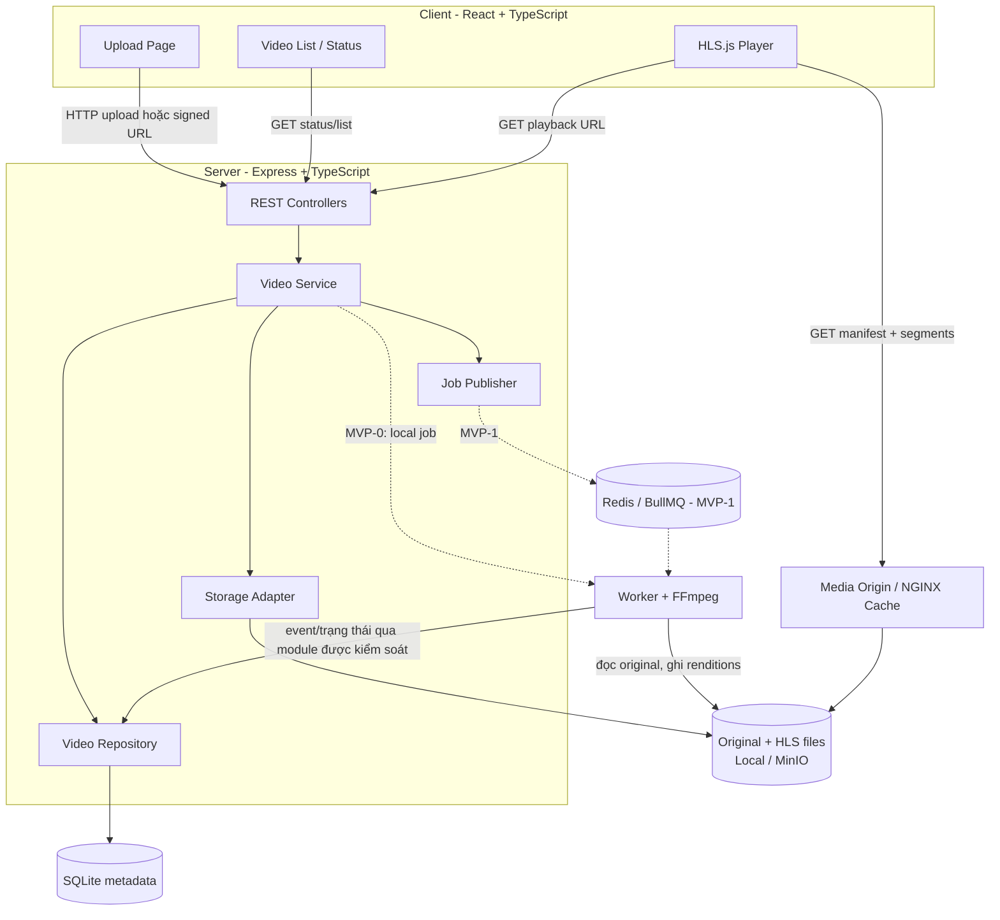
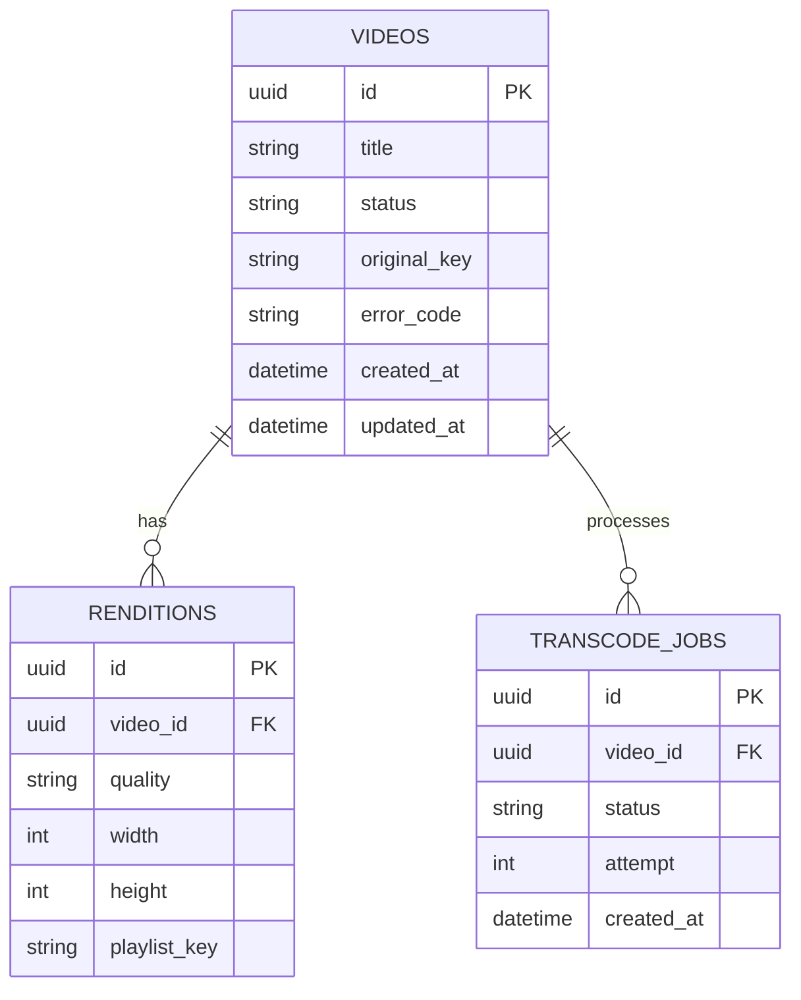
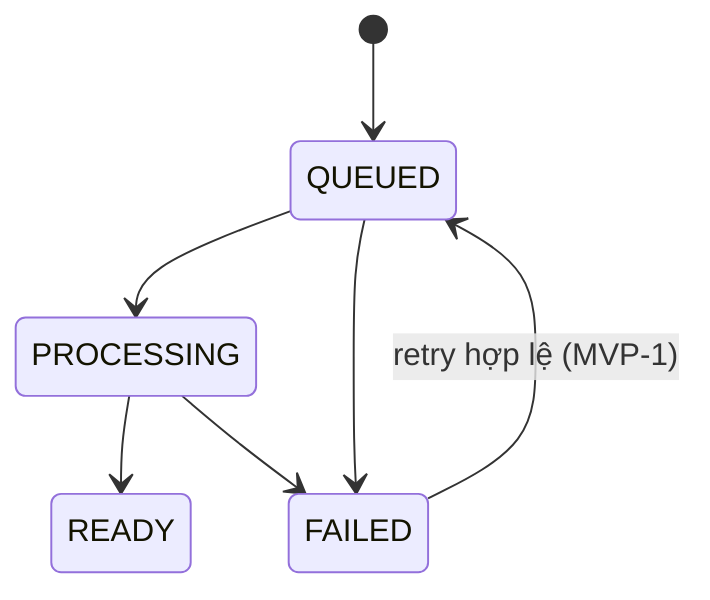
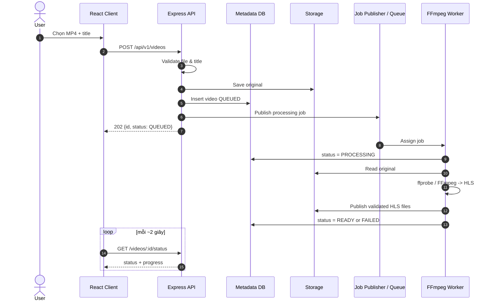
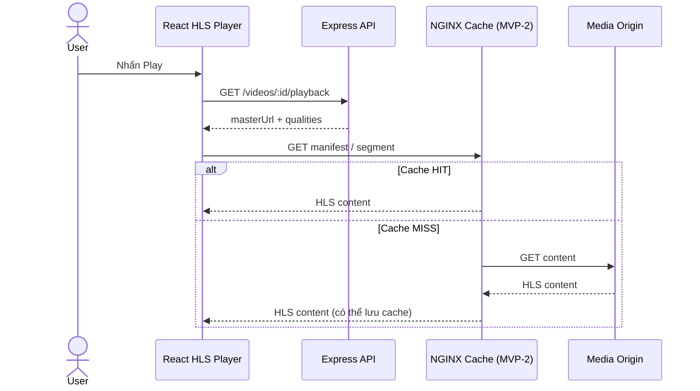

# MINI YOUTUBE — TEAM DEVELOPMENT GUIDE

> **Mã tài liệu:** MYT-TEAM-001  
> **Phiên bản:** 1.0 · **Ngày:** 22/11/2026 · **Trạng thái:** Đề xuất áp dụng  
> **Dự án:** Mini YouTube — mô phỏng kiến trúc *Design YouTube* (Alex Xu, Chương 14)  
> **Tài liệu gốc:** `Mini_YouTube_SRS_SAD_Architecture_v1.docx` (MYT-SRS-SAD-001)  
> **Đối tượng:** Team Lead, Frontend, Backend, Media/Worker, QA/DevOps  
> **Mục đích:** Quy ước chung để cả nhóm triển khai, phối hợp, review, test và demo một hệ thống YouTube thu nhỏ.

> [!IMPORTANT]
> File này là **hướng dẫn phát triển nhóm**, không thay thế SRS/SAD. Nếu có mâu thuẫn về yêu cầu, trạng thái hoặc API, **SRS/SAD v1.0 và OpenAPI được nhóm phê duyệt là nguồn quyết định**. Mọi thay đổi kiến trúc cần có ADR và cập nhật tài liệu.

---

## Mục lục

1. [Mục tiêu và phạm vi](#1-mục-tiêu-và-phạm-vi)
2. [Chiến lược thực hiện](#2-chiến-lược-thực-hiện)
3. [Kiến trúc và ranh giới trách nhiệm](#3-kiến-trúc-và-ranh-giới-trách-nhiệm)
4. [Cấu trúc repository](#4-cấu-trúc-repository)
5. [Nhân sự và phân công](#5-nhân-sự-và-phân-công)
6. [Quy trình làm việc nhóm](#6-quy-trình-làm-việc-nhóm)
7. [Git workflow và Pull Request](#7-git-workflow-và-pull-request)
8. [Quy ước code và kỹ thuật](#8-quy-ước-code-và-kỹ-thuật)
9. [API contract và mô hình dữ liệu](#9-api-contract-và-mô-hình-dữ-liệu)
10. [Thiết kế các luồng nghiệp vụ](#10-thiết-kế-các-luồng-nghiệp-vụ)
11. [Kế hoạch phát triển và backlog](#11-kế-hoạch-phát-triển-và-backlog)
12. [Kiểm thử và tiêu chí nghiệm thu](#12-kiểm-thử-và-tiêu-chí-nghiệm-thu)
13. [Môi trường và hướng dẫn khởi động](#13-môi-trường-và-hướng-dẫn-khởi-động)
14. [Xử lý lỗi, an toàn và quan sát](#14-xử-lý-lỗi-an-toàn-và-quan-sát)
15. [Kịch bản demo và bàn giao](#15-kịch-bản-demo-và-bàn-giao)
16. [ADR, rủi ro và quyết định còn mở](#16-adr-rủi-ro-và-quyết-định-còn-mở)
17. [Checklist bắt đầu làm việc](#17-checklist-bắt-đầu-làm-việc)

---

## 1. Mục tiêu và phạm vi

### 1.1. Mục tiêu chung

Xây một **Mini YouTube hoạt động thực tế trên localhost** để minh họa chuỗi:

**Client upload → Server quản lý metadata → Job xử lý → FFmpeg tạo HLS → Lưu file → Player phát video.**

Nhóm phải giải thích được **tại sao** từng thành phần tồn tại, không chỉ trình diễn UI. Trọng tâm kiến trúc: Client–Server separation, bất đồng bộ, Blob/Object Storage, HLS streaming, mở rộng Worker, xử lý lỗi.

### 1.2. Phạm vi trong MVP

| Mức | Những gì phải làm | Điều kiện hoàn thành |
|---|---|---|
| **MVP-0 — chạy được** | React + Express riêng, SQLite, upload MP4, FFmpeg, HLS 360p/720p, danh sách/trạng thái/phát video, lưu file local | Upload một file nhỏ, nhận `videoId`, đến `READY`, phát được HLS |
| **MVP-1 — bất đồng bộ thực sự** | `worker/` process độc lập; Redis + BullMQ; retry có giới hạn; job/status logs | Dừng và chạy lại Worker, job được xử lý/khôi phục hợp lý; API không chạy FFmpeg |
| **MVP-2 — sát kiến trúc sách hơn** | S3-compatible storage (ví dụ MinIO), upload multipart có ký, resumable upload, NGINX cache | Có thể chứng minh resume và quan sát `MISS → HIT` khi cache hợp lệ |

**Ngoài phạm vi:** mạng CDN đa khu vực thật; 5 triệu DAU; search/recommendation; comment; quảng cáo; livestream; DRM production; deploy công khai chưa có xác thực. Không mô tả những tính năng chưa triển khai như thể đã hoàn tất.

### 1.3. Tiêu chí thành công tối thiểu

- [ ] Frontend tại `http://localhost:5173`, API tại `http://localhost:3001` và có thể chạy/restart riêng.
- [ ] API `GET /api/v1/health` trả HTTP 200.
- [ ] File MP4 hợp lệ, kích thước **≤ 100 MB** theo cấu hình MVP, được nhận và lưu an toàn.
- [ ] Trạng thái chuyển hợp lệ: `QUEUED → PROCESSING → READY` hoặc `FAILED`.
- [ ] FFmpeg tạo `master.m3u8`, playlist và segment; chỉ tạo rendition phù hợp nguồn.
- [ ] React phát video qua `hls.js`, hiển thị Auto / các mức chất lượng sẵn có.
- [ ] Có video mẫu `READY` và kịch bản demo dự phòng.

---

## 2. Chiến lược thực hiện

**Nguyên tắc:** *Contract first → tích hợp sớm → MVP chạy được → mới tăng độ phức tạp.*

1. **Khóa yêu cầu:** SRS (FR/NFR), API và trạng thái video; mọi người thống nhất một cách hiểu.
2. **Dựng skeleton:** thư mục `client/`, `server/`, `contracts/`, `docs/`, các cổng, `.env.example`.
3. **Frontend và Backend làm song song:** FE dùng mock JSON đúng contract, BE triển khai endpoint thật; tích hợp sớm.
4. **Nối end-to-end:** upload một MP4 → trả ID → status → HLS → playback.
5. **Tách Worker:** thay cơ chế local bằng BullMQ nhưng **không phá API contract**.
6. **Tối ưu và demo:** storage adapter, cache, retry, kiểm thử và báo cáo giới hạn.

> Không nên bắt đầu bằng Docker Compose gồm tất cả dịch vụ khi API upload và phát HLS còn chưa chạy. Mọi mốc phải có bản có thể trình diễn.

---

## 3. Kiến trúc và ranh giới trách nhiệm

### 3.1. Kiến trúc logic



**Chú ý:** sơ đồ thể hiện kiến trúc mục tiêu và các adapter. Ở MVP-0, Worker có thể được gọi nội bộ từ backend sau khi request upload kết thúc; sang MVP-1 mới có Queue thật và process độc lập. `NGINX Cache` chỉ mô phỏng một CDN Edge trên localhost, **không phải CDN phân tán thật**.

### 3.2. Quyền và trách nhiệm từng tầng

| Tầng | Chịu trách nhiệm | Không được làm |
|---|---|---|
| **Client** | Form, giao diện, request API, polling status, HLS playback, thông báo lỗi | Đọc DB/Redis, gọi FFmpeg, chứa credentials storage |
| **Server** | Validate, metadata, business rules, trạng thái, cấp URL, publish job, lỗi API | Encode video nặng ngay trong HTTP request đồng bộ |
| **Worker** | Nhận job, ffprobe/FFmpeg, kiểm tra HLS, báo kết quả, retry hợp lý | Xử lý giao diện hoặc tự cấp quyền public |
| **Infrastructure** | DB, Redis, MinIO, proxy/cache, scripts triển khai | Chứa business logic gắn với UI |
| **Contracts** | OpenAPI, request/response/error schema và versioning | Phụ thuộc trực tiếp vào mã nội bộ một app |

### 3.3. Hai đường truyền bắt buộc phân biệt

- **Control/API path:** lấy danh sách, metadata, trạng thái, quyền và playback URL qua `/api/v1`.
- **Video/data path:** lưu original và các HLS file; Player tải `master.m3u8`/segments qua media origin hoặc cache. Không truyền mỗi segment qua controller nghiệp vụ.
- **Completion path:** Worker hoàn tất/lỗi → cập nhật metadata hợp lệ → Client thấy trạng thái mới.

---

## 4. Cấu trúc repository

Đề xuất **monorepo**: một Git repository giúp review đồng bộ, nhưng code và runtime vẫn tách biệt.

```text
mini-youtube/
├── client/                         # React + Vite + TypeScript
│   ├── src/
│   │   ├── app/                    # Router, app providers
│   │   ├── components/             # UI dùng chung
│   │   ├── features/
│   │   │   ├── uploads/
│   │   │   ├── videos/
│   │   │   └── playback/
│   │   ├── services/               # API client từ contract
│   │   └── types/
│   ├── .env.example
│   ├── package.json
│   └── README.md
├── server/                         # Express + TypeScript
│   ├── src/
│   │   ├── app.ts
│   │   ├── index.ts
│   │   ├── modules/videos/
│   │   │   ├── video.routes.ts
│   │   │   ├── video.controller.ts
│   │   │   ├── video.service.ts
│   │   │   └── video.repository.ts
│   │   ├── adapters/
│   │   │   ├── storage/
│   │   │   ├── queue/
│   │   │   └── media/
│   │   ├── middleware/
│   │   ├── database/
│   │   └── utils/
│   ├── .env.example
│   └── package.json
├── worker/                         # Process riêng từ MVP-1
│   ├── src/transcoding/
│   ├── .env.example
│   └── package.json
├── contracts/
│   ├── openapi.yaml                # HỢP ĐỒNG API CHÍNH
│   └── examples/
├── infrastructure/
│   ├── docker-compose.yml         # Redis / MinIO ở các mốc sau
│   └── nginx/
├── docs/
│   ├── SRS_SAD.md                  # Bản tóm lược hoặc link về DOCX gốc
│   ├── adr/
│   ├── architecture/
│   └── demo/
├── scripts/
├── .github/
│   ├── workflows/
│   └── PULL_REQUEST_TEMPLATE.md
├── .gitignore
└── README.md
```

**Quy tắc:** không import trực tiếp mã nguồn từ `client/src` vào `server/src` hoặc ngược lại. Mọi thông tin trao đổi đi qua JSON, HTTP, OpenAPI và media URL hợp lệ. Nếu cần chia sẻ type, sinh type từ OpenAPI hoặc một package contracts thuần; không chia sẻ business service.

---

## 5. Nhân sự và phân công

> Điền tên thật trước khi bắt đầu. Một người có thể kiêm nhiều vai trò nếu team ít thành viên; **mỗi task chỉ có một người chịu trách nhiệm chính**.

| Vai trò | Owner (điền tên) | Phạm vi | Deliverables |
|---|---|---|---|
| **TL / Architect** | `TBD` | Chốt SRS/SAD, API contract, ADR, tích hợp và review | Roadmap, PR approval, demo tổng |
| **Frontend** | `TBD` | React UI, upload state, status polling, HLS.js | Trang list/upload/detail/playback |
| **Backend** | `TBD` | Express API, SQLite, validation, repositories, storage adapter | API `/api/v1`, migrations, test |
| **Media / Worker** | `TBD` | FFmpeg, HLS profiles, BullMQ, retry, output validation | Transcoding runner, Queue/Worker |
| **QA / DevOps** | `TBD` | Smoke test, CI, `.env.example`, Docker/NGINX, tài liệu chạy | Test report, demo checklist |

### 5.1. Ownership theo thư mục

- `client/**` → Frontend; BE/TL review thay đổi liên quan API.
- `server/**` → Backend; TL review business rules/schema.
- `worker/**` → Media/Worker; BE review hợp đồng job/event.
- `contracts/**` → **TL + FE + BE cùng duyệt** trước khi merge.
- `infrastructure/**` → DevOps/Media; TL review.
- `docs/adr/**` → người đề xuất viết; TL duyệt.

### 5.2. Quy tắc phối hợp FE–BE

1. BE/TL đề xuất endpoint trong `contracts/openapi.yaml`.
2. FE xác nhận input/output đủ để dựng UI; BE xác nhận status/error phù hợp.
3. Merge **contract trước**. FE dùng mock JSON từ `contracts/examples/`, BE implement API độc lập.
4. Tích hợp trên branch/PR nhỏ, kiểm tra Network và phản hồi lỗi thực tế.
5. Không đổi tên trường JSON hoặc mã trạng thái mà không thông báo và cập nhật contract.

---

## 6. Quy trình làm việc nhóm

### 6.1. Board công việc

Sử dụng GitHub Issues/Projects hoặc Jira. Trạng thái đề xuất:

`BACKLOG → READY → IN PROGRESS → IN REVIEW → TESTING → DONE`

Nếu thiếu dependency, đưa về **BLOCKED** và ghi rõ đang chờ ai / chờ điều gì.

### 6.2. Definition of Ready (DoR)

Task chỉ được kéo vào `IN PROGRESS` khi:

- [ ] Có ID, tiêu đề, owner, ưu tiên, mốc MVP và thời gian dự kiến.
- [ ] Có yêu cầu liên quan (FR/NFR) hoặc ADR.
- [ ] Có mô tả input/output, test case và tiêu chí nghiệm thu.
- [ ] Không còn câu hỏi kiến trúc ngăn việc triển khai; dependency đã được liệt kê.

### 6.3. Nhịp phối hợp (đề xuất)

- **Daily 10 phút:** hôm qua làm gì, hôm nay làm gì, đang vướng gì.
- **Tích hợp mỗi ngày:** FE và BE cùng test ít nhất một API trên bản mới nhất.
- **Review theo milestone:** demo luồng đang chạy, không chỉ báo cáo phần trăm tiến độ.
- **Cuối tuần/mốc:** cập nhật backlog, ADR và ảnh/video demo, ghi nhận lỗi tồn đọng.

### 6.4. Mẫu Issue

```md
## [MYT-012] Implement video status endpoint
- Owner: Backend
- Priority: P0
- Milestone: M1
- Requirement: FR-03
- Depends on: MYT-006 (SQLite schema)

### Mô tả
GET /api/v1/videos/:id/status trả trạng thái có trong DB.

### Acceptance criteria
- [ ] Trả id, status, progress (có thể null), error (nếu FAILED)
- [ ] videoId không tồn tại trả 404 VIDEO_NOT_FOUND
- [ ] Có unit/integration test
- [ ] Contract và README được cập nhật
```

---

## 7. Git workflow và Pull Request

### 7.1. Nhánh Git

- `main`: luôn ở trạng thái build được, đủ để demo những gì đã merge.
- `feat/MYT-012-video-status`: chức năng mới.
- `fix/MYT-018-hls-playback`: sửa lỗi.
- `docs/MYT-004-api-contract`: tài liệu.
- `chore/MYT-020-ci`: cấu hình và bảo trì.

Không push trực tiếp lên `main`. Rebase/merge từ `main` thường xuyên để tránh xung đột tích hợp.

### 7.2. Commit convention

Ưu tiên **Conventional Commits**:

```text
feat(client): add upload progress view
feat(server): implement video status endpoint
feat(worker): generate adaptive HLS renditions
fix(server): prevent path traversal in upload
chore(ci): run lint and tests
docs: update API examples
```

### 7.3. Pull Request bắt buộc có

```md
## Mục tiêu
Tóm tắt thay đổi và issue liên quan: Closes #...

## Phạm vi
- [ ] Client  - [ ] Server  - [ ] Worker  - [ ] Contract  - [ ] Infra

## Kiểm thử
- Lệnh test/lint/build đã chạy:
- Bằng chứng: screenshot, video ngắn hoặc API response

## Ảnh hưởng
- Thay đổi API/DB/ENV? Có/Không
- Cần migration hoặc cập nhật tài liệu? Có/Không

## Checklist
- [ ] Không commit .env, token, video lớn, database file
- [ ] Contract đã cập nhật nếu thay đổi API
- [ ] Có test cho happy path và error path
- [ ] Không có warning/lỗi nghiêm trọng
```

**Merge khi:** có ít nhất 1 người review, CI xanh (khi đã cấu hình), issue có bằng chứng chạy thật; thay đổi API phải được FE/BE đồng thuận. Với nhóm rất nhỏ, TL có thể là reviewer nhưng tác giả không tự duyệt thay đổi quan trọng.

---

## 8. Quy ước code và kỹ thuật

### 8.1. Ngôn ngữ và kiến trúc

- TypeScript cho cả Client và Server; bật `strict` khi có thể.
- ESLint + Prettier với config nhất quán; không merge code còn lỗi lint.
- Tên file và biến bằng tiếng Anh; comment tiếng Việt/Anh đều được nhưng phải mô tả **tại sao**, không chỉ nhắc lại code.
- Server đi theo `route → controller → service → repository/adapter`.
- Client đi theo `page/component → feature hooks/services → HTTP API`.
- Không hardcode host, credentials, đường dẫn hệ điều hành hoặc URL media nội bộ.

### 8.2. API/data validation

- Frontend validate để cải thiện UX, **Server luôn validate lại**.
- DTO request/response có schema; lỗi API nhất quán `code`, `message`, `requestId`.
- Không trả `original_key`, internal filesystem path hay token/signed URL trong log.
- Tất cả timestamp trao đổi sử dụng UTC ISO 8601; ID video là UUID.
- Dùng HTTP status phù hợp (202, 400, 404, 409, 413, 415, 422, 500).

### 8.3. Upload/FFmpeg an toàn

- MVP chạy **localhost**. Mặc định giới hạn file MP4 ≤ 100 MB, có thể cấu hình.
- Kiểm tra file size, kiểu nội dung, chữ ký dữ liệu và khả năng giải mã (`ffprobe`).
- Không dùng tên file người dùng làm tên file lưu vật lý; dùng UUID và tên chuẩn hóa.
- Dùng `spawn`/`execFile` với **mảng đối số**, không ghép input người dùng vào shell string.
- Giới hạn số job song song, timeout, dung lượng đĩa và thời lượng video demo.
- Worker phải idempotent: cùng `videoId + profileVersion` không tạo kết quả công bố trùng hoặc mâu thuẫn.

---

## 9. API contract và mô hình dữ liệu

### 9.1. Endpoint baseline (theo SRS/SAD v1.0)

| Method | Endpoint | Input | Output / ý nghĩa | MVP |
|---|---|---|---|---|
| `GET` | `/api/v1/health` | — | `{ "status": "ok" }` | M0 |
| `GET` | `/api/v1/videos` | `page`, `limit` tùy chọn | Danh sách video DTO | M1 |
| `POST` | `/api/v1/videos` | `multipart/form-data`: `title`, `file` | `202 Accepted`, `{ id, status: "QUEUED" }` sau khi lưu original | M1 |
| `GET` | `/api/v1/videos/:id` | `videoId` | Chi tiết video | M1 |
| `GET` | `/api/v1/videos/:id/status` | `videoId` | `{ id, status, progress, error? }` | M1 |
| `GET` | `/api/v1/videos/:id/playback` | `videoId` | `{ masterUrl, qualities[] }` nếu READY | M2 |
| `POST` | `/api/v1/videos/:id/retry` | `videoId` | `202` khi retry hợp lệ | M3 |

**Ví dụ response upload:**

```json
{
  "id": "c6d0ef71-82a3-45f0-a223-b99ad67edceb",
  "status": "QUEUED"
}
```

**Ví dụ status:**

```json
{
  "id": "c6d0ef71-82a3-45f0-a223-b99ad67edceb",
  "status": "PROCESSING",
  "progress": 45,
  "error": null
}
```

**Ví dụ playback:**

```json
{
  "masterUrl": "http://localhost:3001/media/c6d0ef71-82a3-45f0-a223-b99ad67edceb/master.m3u8",
  "qualities": ["360p", "720p"]
}
```

**Ví dụ lỗi:**

```json
{
  "error": {
    "code": "VIDEO_NOT_READY",
    "message": "Video is being processed",
    "requestId": "req_123"
  }
}
```

> Thống nhất chính xác envelope lỗi cuối cùng trong `contracts/openapi.yaml` trước khi FE và BE triển khai; snippet ở đây là ví dụ quy ước. Với video chưa READY, `/playback` trả HTTP `409` thay vì client đoán URL.

### 9.2. Error codes cần thống nhất

| HTTP | Code | Ý nghĩa |
|---|---|---|
| `400` | `INVALID_REQUEST` | Thiếu trường / yêu cầu không hợp lệ |
| `404` | `VIDEO_NOT_FOUND` | ID không tồn tại |
| `409` | `VIDEO_NOT_READY` | Chưa có HLS phát được |
| `413` | `UPLOAD_TOO_LARGE` | File quá giới hạn |
| `415` | `UNSUPPORTED_MEDIA` | File/kiểu nội dung không hỗ trợ |
| `422` | `VIDEO_DECODE_ERROR` | Không giải mã được video |
| `500` | `INTERNAL_ERROR` | Lỗi nội bộ không dự kiến |

### 9.3. Data model tối thiểu



- `VIDEOS`: metadata nguồn sự thật. `status ∈ {QUEUED, PROCESSING, READY, FAILED}` ở MVP-0.
- `RENDITIONS`: mỗi video có 0..n bản chất lượng; unique `(video_id, quality)`.
- `TRANSCODE_JOBS`: bảng tùy chọn khi cần audit; ở MVP-1 trạng thái thực thi job nằm trong BullMQ.
- `original_key`, `playlist_key` là key nội bộ, không dùng làm public URL trực tiếp.

### 9.4. Quy tắc trạng thái



- Chỉ phát video khi `READY`; không bao giờ báo `READY` nếu manifest/segment chưa kiểm chứng.
- Với nguồn chất lượng thấp, không cố sinh 720p; manifest chỉ chứa rendition thực tế có được.
- Ở MVP-2, multipart upload thêm bước `CREATED → UPLOADING` trước `QUEUED`, không sửa ngược ý nghĩa các trạng thái đang dùng.

---

## 10. Thiết kế các luồng nghiệp vụ

### 10.1. Upload → Processing → Ready



**MVP-0:** Job Publisher có thể là local adapter chạy sau khi request upload hoàn tất; cần xử lý crash/restart và không giả vờ đây là queue bền vững. **MVP-1:** thay bằng Redis/BullMQ + Worker process riêng. Trình tự save metadata, publish job và response phải kiểm soát lỗi để tránh trạng thái `QUEUED` ảo khi không publish được.

### 10.2. Playback / CDN cache



**MVP-0:** Player lấy HLS trực tiếp từ `/media`; không cần triển khai NGINX. **MVP-2:** cache proxy có thể nhận các file HLS, trả `X-Cache-Status` để quan sát `MISS → HIT` khi cấu hình phù hợp. Không cache sai dữ liệu riêng tư.

### 10.3. Mốc nâng cấp multipart upload

Không dùng lại logic `multipart/form-data` MVP-0 như thể là pre-signed multipart. API tương lai gồm:

- `POST /api/v1/uploads/initiate`
- `POST /api/v1/uploads/:uploadId/parts/sign`
- `POST /api/v1/uploads/:uploadId/complete`
- `POST /api/v1/uploads/:uploadId/abort`

Chỉ publish job khi object lưu trữ được xác nhận đầy đủ và hợp lệ; Client không giữ storage secret.

---

## 11. Kế hoạch phát triển và backlog

### 11.1. Milestone có thể kiểm chứng

| Mốc | Trọng tâm | Đầu ra demo | Dependencies |
|---|---|---|---|
| **M0 — Skeleton** | Repo, Client/Server, OpenAPI, DB design, `/health` | FE gọi được health API | Không |
| **M1 — Upload + Metadata** | Upload MP4, SQLite, list/detail/status | Upload trả ID, hiện QUEUED | M0 |
| **M2 — HLS** | FFmpeg 360p/720p, HLS.js, `/playback` | Xem video READY và chọn quality | M1 |
| **M3 — Async Worker** | Redis, BullMQ, worker độc lập, retry | Tắt/bật worker và kiểm tra queue | M2 |
| **M4 — Object Storage** | Storage adapter MinIO + signed multipart | Multipart resumable được chứng minh | M3 |
| **M5 — Cache & Reliability** | NGINX cache, test lỗi, CI | DevTools thấy MISS/HIT + test report | M4 |

> Milestone không phải cam kết thời gian. Ước lượng sau khi kiểm tra máy của nhóm, FFmpeg và thời lượng video mẫu.

### 11.2. Backlog phân công ban đầu

| ID | Task | Owner | Ưu tiên | Mốc | Done khi |
|---|---|---|---|---|---|
| `MYT-001` | Khởi tạo repo, scripts, `.gitignore`, README | TL | P0 | M0 | Clone xong có thể chạy FE/BE độc lập |
| `MYT-002` | Thiết kế `contracts/openapi.yaml` và examples | TL + FE + BE | P0 | M0 | FE/BE review và thống nhất schema |
| `MYT-003` | React app/router, layout cơ bản | FE | P0 | M0 | Trang chủ tải được |
| `MYT-004` | Express app, `/health`, CORS, error middleware | BE | P0 | M0 | Health 200, lỗi có requestId |
| `MYT-005` | SQLite schema + repository + migration | BE | P0 | M1 | Insert/find/list video, có test |
| `MYT-006` | Upload endpoint + validate + local storage | BE | P0 | M1 | MP4 hợp lệ trả 202, lỗi đúng mã |
| `MYT-007` | Upload UI + progress và list | FE | P0 | M1 | FE gọi API thật, hiển thị kết quả |
| `MYT-008` | GET detail/status, polling UI | BE + FE | P0 | M1 | Trạng thái hiển thị đúng |
| `MYT-009` | FFmpeg runner, HLS output + manifest validation | Media | P0 | M2 | Sinh segment/playlist phát được |
| `MYT-010` | Playback endpoint + serve media | BE | P0 | M2 | READY trả URL hợp lệ; chưa READY = 409 |
| `MYT-011` | HLS.js player + quality selector | FE | P0 | M2 | Phát HLS, chọn rendition có sẵn |
| `MYT-012` | End-to-end tests, demo video dự phòng | QA | P0 | M2 | Script test và checklist có bằng chứng |
| `MYT-013` | BullMQ + Redis + Worker process | BE + Media | P1 | M3 | Backend không chạy FFmpeg; xử lý job thật |
| `MYT-014` | Retry, worker idempotency, metrics | Media | P1 | M3 | Crash/restart, retry giới hạn |
| `MYT-015` | MinIO StorageAdapter, multipart signed URLs | BE | P2 | M4 | Upload part, complete và resume |
| `MYT-016` | UI resumable upload | FE | P2 | M4 | Mất mạng thử lại các part thiếu |
| `MYT-017` | NGINX cache và HIT/MISS proof | QA/DevOps | P2 | M5 | Network/header thể hiện cache |
| `MYT-018` | CI, ADR, test report, script demo | TL + QA | P1 | M5 | Build/test tự động, demo tái lập |

**Ưu tiên ngày đầu:** `MYT-001 → MYT-002 → MYT-003/MYT-004` (FE/BE làm song song). Tiếp tục `MYT-005/MYT-006` và `MYT-007/MYT-008`; không đợi UI hoàn chỉnh mới tích hợp.

### 11.3. Thứ tự dependency khuyến nghị

```text
M0: repo + API contract + /health
                  │
                  ▼
M1: upload + DB + status API + UI
                  │
                  ▼
M2: FFmpeg → HLS → Playback   ← mốc có thể bảo vệ/demo
                  │
                  ▼
M3: Redis/BullMQ + Worker + retry
                  │
                  ▼
M4: MinIO + multipart/resume
                  │
                  ▼
M5: NGINX Cache + CI + hardening
```

---

## 12. Kiểm thử và tiêu chí nghiệm thu

### 12.1. Test cases trọng tâm

| Test ID | Trường hợp | Kết quả mong đợi |
|---|---|---|
| `T-01` | Mở video list | Trả list và hiển thị trạng thái |
| `T-02` | Upload MP4 ≤ 100 MB | HTTP 202, nhận `id`, original được lưu |
| `T-03` | Upload file > giới hạn | HTTP 413 `UPLOAD_TOO_LARGE` |
| `T-04` | Upload file không giải mã được | `FAILED` + mã lỗi phù hợp; không READY |
| `T-05` | Polling status | `QUEUED → PROCESSING → READY/FAILED` nhất quán |
| `T-06` | FFmpeg tạo HLS | Manifest/segment hiện diện và đọc được |
| `T-07` | Video READY phát được | HLS.js chạy, Network thấy `.m3u8` và segment |
| `T-08` | Video chưa READY gọi playback | HTTP 409 `VIDEO_NOT_READY` |
| `T-09` | Source < 720p | Không quảng cáo 720p nếu không được tạo |
| `T-10` | Kill/restart Worker (MVP-1) | Không mất vĩnh viễn job, xử lý trùng an toàn |
| `T-11` | Gián đoạn multipart (MVP-2) | Tiếp tục được các part chưa upload |
| `T-12` | Request media 2 lần (MVP-2) | Quan sát MISS rồi HIT khi cache phù hợp |

### 12.2. Definition of Done (DoD)

Một task chỉ được đánh dấu `DONE` khi:

- [ ] Đáp ứng acceptance criteria của issue và FR tương ứng.
- [ ] Code lint/build thành công; unit/integration test liên quan chạy qua.
- [ ] Có bằng chứng thực tế: ảnh, clip ngắn, output `curl`, hoặc log được làm sạch thông tin nhạy cảm.
- [ ] Không để lại endpoint mock khiến người dùng hiểu nhầm là tính năng hoàn chỉnh.
- [ ] `.env.example`, API contract, migration hoặc README được cập nhật nếu cần.
- [ ] PR được review/merge; task được kéo sang `DONE` và ghi rõ commit/PR liên quan.

### 12.3. Không được tự nhận đã xong nếu

- Worker thực tế đang chạy trong API process nhưng báo “Worker độc lập”.
- Có link `.m3u8` nhưng thiếu segments hoặc manifest sai.
- Chỉ có một rendition mà giao diện vẫn hiện 360p, 720p, 1080p.
- Trạng thái `READY` được set trước khi kiểm tra file HLS.
- Dùng NGINX trên một máy nhưng khẳng định đã xây dựng CDN đa vùng.

---

## 13. Môi trường và hướng dẫn khởi động

### 13.1. Công nghệ chọn theo SRS/SAD

| Thành phần | Công nghệ | Giai đoạn |
|---|---|---|
| Frontend | React + TypeScript + Vite, hls.js | M0–M2 |
| Backend | Node.js + Express + TypeScript | M0–M2 |
| Metadata | SQLite local; có adapter để đổi PostgreSQL | M1 |
| Media | FFmpeg và FFprobe | M2 |
| Queue | Redis + BullMQ | M3 |
| Storage | Local disk → MinIO/S3-compatible | M1 → M4 |
| Delivery | Static `/media` → NGINX cache | M2 → M5 |

### 13.2. Cổng và ví dụ env

| Dịch vụ | Địa chỉ đề xuất | Ghi chú |
|---|---|---|
| Client | `http://localhost:5173` | Vite dev server |
| API | `http://localhost:3001` | prefix `/api/v1` |
| Media local | `http://localhost:3001/media` | Chỉ các tệp media hợp lệ |
| Redis | `redis://localhost:6379` | M3; không truy cập từ browser |
| MinIO | `http://localhost:9000` | M4; credentials ở server/worker |
| NGINX cache | `http://localhost:8080` | M5; mô phỏng cache proxy |

`client/.env.example`:

```dotenv
VITE_API_BASE_URL=http://localhost:3001/api/v1
```

`server/.env.example`:

```dotenv
NODE_ENV=development
PORT=3001
CLIENT_ORIGIN=http://localhost:5173
DATABASE_URL=file:./data/mini-youtube.db
MAX_UPLOAD_MB=100
MEDIA_DIR=./storage
# M3: REDIS_URL=redis://localhost:6379
# M4: S3_ENDPOINT=http://localhost:9000
# M4: S3_ACCESS_KEY=replace_in_local_env_only
# M4: S3_SECRET_KEY=replace_in_local_env_only
```

`worker/.env.example` (M3):

```dotenv
REDIS_URL=redis://localhost:6379
FFMPEG_PATH=ffmpeg
FFPROBE_PATH=ffprobe
WORKER_CONCURRENCY=1
```

**Không commit `.env` thật hoặc credentials.** Mọi biến bắt đầu `VITE_` được đưa vào bundle client; chỉ dùng cho cấu hình công khai.

### 13.3. Nguyên tắc chạy local

- Bảo đảm Node.js, npm và FFmpeg/FFprobe đã có trong `PATH` bằng cách kiểm tra `node -v`, `npm -v`, `ffmpeg -version`, `ffprobe -version`.
- Mỗi app có `package.json`/scripts riêng: `dev`, `build`, `lint`, `test`.
- Chạy `server/` và `client/` ở hai terminal riêng. Khi tới M3, chạy thêm `worker/` và Redis.
- Tất cả ví dụ script trong tài liệu là **quy ước dự án cần triển khai**, không phải khẳng định mã nguồn hiện đã tồn tại.
- Test đầu tiên: `GET http://localhost:3001/api/v1/health`.

Ví dụ smoke test khi Server đã được nhóm triển khai:

```bash
curl http://localhost:3001/api/v1/health
curl -F "title=Demo YouTube" -F "file=@sample.mp4" http://localhost:3001/api/v1/videos
# Dùng id trả về để kiểm tra trạng thái
curl http://localhost:3001/api/v1/videos/VIDEO_ID/status
```

### 13.4. Quy ước gitignore tối thiểu

```gitignore
**/node_modules/
**/dist/
**/.env
**/.env.local
**/coverage/
server/data/
server/storage/
worker/output/
*.db
*.db-shm
*.db-wal
*.mp4
```

**Lưu ý:** Tuyệt đối không thêm pattern `*.ts` toàn cục vào `.gitignore`, vì sẽ che mất file nguồn TypeScript. Chỉ ignore thư mục output HLS (ví dụ `server/storage/`, `worker/output/`). Với `sample.mp4`, dùng fixture nhỏ có quyền sử dụng phù hợp hoặc hướng dẫn tạo fixture; tránh commit video nặng.

---

## 14. Xử lý lỗi, an toàn và quan sát

### 14.1. Quy tắc phục hồi

| Sự cố | Ở mốc nào | Cách xử lý |
|---|---|---|
| Kết nối upload mất | M0/M4 | MVP-0: upload lại; MVP-2: resume từng part |
| MP4 lỗi/không giải mã | M2 | `FAILED`, `VIDEO_DECODE_ERROR`, không retry vô hạn |
| FFmpeg trả exit code khác 0 | M2/M3 | Ghi log ngắn gọn, đánh `FAILED` hoặc retry có giới hạn |
| Worker bị tắt | M3 | BullMQ stalled/retry có kiểm soát; idempotent output |
| Redis unavailable | M3 | Không báo `QUEUED` thành công nếu publish job thất bại |
| DB unavailable | M1+ | Không cập nhật `READY` ảo; log/cảnh báo, retry theo policy |
| Cache MISS | M5 | Lấy từ origin; không xem là failure |

### 14.2. Log tối thiểu

```text
timestamp | level | requestId | videoId | jobId | event | durationMs | errorCode
```

Không log token, storage secret, full signed URL. Các chỉ số nên quan sát: upload success ratio, time-to-ready, job queue depth, worker failures/retries, playback errors, cache hit ratio.

### 14.3. Giới hạn demo

- Localhost chỉ để chứng minh thiết kế, **không đủ để suy ra 5 triệu DAU hay khả năng scale thật**.
- Nếu muốn public, phải bổ sung xác thực, ownership, quota, rate-limit, HTTPS, bảo vệ nội dung và kiểm soát cache.
- Chỉ cho phép xem video có trạng thái `READY`; file xử lý dở hoặc lỗi không được đưa vào playlist public.

---

## 15. Kịch bản demo và bàn giao

### 15.1. Demo trước giảng viên (~60–90 giây)

1. Mở trang danh sách và cho thấy một video `READY` dự phòng.
2. Chọn video MP4 ngắn, bấm Upload; UI trả `videoId` và trạng thái.
3. Giải thích job được gửi tới xử lý; theo dõi `PROCESSING → READY` (nếu xử lý mất lâu thì dùng video đã sẵn sàng).
4. Nhấn Play; mở DevTools Network chỉ ra `master.m3u8` và một segment.
5. Chuyển chất lượng 360p/720p nếu bản đó tồn tại.
6. Nếu đã làm M3/M5, giới thiệu Queue/Worker hoặc `MISS → HIT` như phần nâng cao.

### 15.2. Checklist bàn giao team

- [ ] Code trên `main` build và chạy theo README.
- [ ] README mô tả sơ đồ kiến trúc, prereqs, env, lệnh start, địa chỉ URL, demo.
- [ ] OpenAPI hiện tại khớp Server và Client.
- [ ] Có migrations/seed hoặc lệnh tạo SQLite mới.
- [ ] Có video demo nhỏ và cách tạo video thay thế hợp lệ.
- [ ] Có bảng test case và kết quả chạy thực tế.
- [ ] Có ADR giải thích các quyết định đáng kể.
- [ ] Ghi rõ phần đã chạy được và phần chưa thực hiện.

---

## 16. ADR, rủi ro và quyết định còn mở

### 16.1. Architecture Decision Records

| ADR | Quyết định | Trạng thái |
|---|---|---|
| `ADR-001` | React + Express chạy độc lập, monorepo | Đã chọn |
| `ADR-002` | OpenAPI là nguồn sự thật cho FE–BE | Đã chọn |
| `ADR-003` | SQLite cho MVP-0, adapter sẵn sàng đổi DB | Đã chọn |
| `ADR-004` | Local StorageAdapter → MinIO/S3 | Đã chọn |
| `ADR-005` | Local job adapter → Redis/BullMQ, Worker riêng | Đã chọn |
| `ADR-006` | MP4 100 MB, HLS 360p/720p theo nguồn | Cần benchmark máy demo |
| `ADR-007` | Branch protection, 1 PR reviewer, CI tối thiểu | Đề xuất team phê duyệt |

Mỗi ADR ở `docs/adr/NNN-title.md` cần có: **Context → Decision → Alternatives → Consequences → Status**.

### 16.2. Rủi ro chính

| Rủi ro | Tác động | Giảm thiểu |
|---|---|---|
| Máy demo transcoding chậm | Demo quá thời lượng | Dùng MP4 10–20 giây, có video READY dự phòng |
| FE/BE lệch JSON field | Tích hợp thất bại | OpenAPI + example DTO được duyệt từ M0 |
| Khó cài MinIO/Redis/NGINX | Không kịp có demo | Dừng ở M2 khi cần; các mốc sau là tùy chọn |
| Worker tạo file lỗi một phần | Player không phát | Staging output + validate rồi mới publish READY |
| Thay đổi yêu cầu liên tục | Trễ tích hợp | Issue + ADR + review phạm vi tác động |
| Lộ credentials/log nhạy cảm | Mất an toàn | `.env`, gitignore, config review, chỉ localhost |

### 16.3. Những quyết định team cần chốt

- [ ] Thành viên/owner thực tế của từng nhánh công việc.
- [ ] Có cần login trong demo hay chỉ video công khai trên localhost?
- [ ] Giới hạn thời lượng video, profile FFmpeg và thời gian xử lý mục tiêu trên máy thật.
- [ ] Ai duyệt `contracts/openapi.yaml` và thay đổi breaking API?
- [ ] Dùng GitHub Projects hay Jira cho board?
- [ ] Có yêu cầu triển khai LAN/public không? Nếu có, lập hạng mục bảo mật mới.

---

## 17. Checklist bắt đầu làm việc

### Buổi đầu tiên — Team Lead

- [ ] Đưa `TEAM_DEVELOPMENT_GUIDE.md` vào root repo và `Mini_YouTube_SRS_SAD_Architecture_v1.docx` vào `docs/`.
- [ ] Tạo repo, branch protection (`main`), issue labels và board.
- [ ] Gắn owner cho `MYT-001` đến `MYT-004`.
- [ ] Chốt danh sách FR/NFR bắt buộc của MVP-0.
- [ ] Mở PR đầu tiên cho `contracts/openapi.yaml`.

### Buổi đầu tiên — Frontend

- [ ] Khởi tạo `client/` React + TypeScript + Vite.
- [ ] Tạo các màn `VideoList`, `Upload`, `VideoDetail/Playback` skeleton.
- [ ] Thiết lập API base URL, types và mock response từ contract.
- [ ] Kiểm tra gọi `/api/v1/health` và cách hiển thị lỗi API.

### Buổi đầu tiên — Backend

- [ ] Khởi tạo `server/` Express + TypeScript.
- [ ] Tạo `/api/v1/health`, middleware xử lý lỗi, CORS theo origin FE.
- [ ] Thiết kế Video entity, trạng thái, migration SQLite.
- [ ] Thống nhất schema upload/list/status với FE trước khi implement.

### Buổi đầu tiên — Media/QA

- [ ] Kiểm tra `ffmpeg` và `ffprobe` trên máy chạy demo.
- [ ] Chuẩn bị video MP4 ngắn hợp lệ, video độ phân giải thấp để thử edge case.
- [ ] Xác định cấu trúc output HLS và cách validate manifest/segment.
- [ ] Viết `T-01` đến `T-09` thành test checklist dùng được.

### Nguyên tắc kết thúc mỗi buổi

**Mỗi người phải có:** (1) commit/PR hoặc tài liệu cụ thể; (2) bằng chứng chạy/test; (3) blocker nếu có; (4) nhiệm vụ tiếp theo. Không dùng “xong 80%” thay cho kết quả có thể kiểm chứng.

---

## Tài liệu tham chiếu

- `Mini_YouTube_SRS_SAD_Architecture_v1.docx` — yêu cầu, kiến trúc, API, data model và milestone đã thống nhất.
- `Ke_hoach_thuc_hanh_Mini_YouTube_ngay_mai.docx` — hướng dẫn thực hành MVP local.
- `Thiet-ke-he-thong-YouTube.pptx` — 10 slide minh họa về scale, video/API path, upload, streaming, transcoding, resilience.
- Alex Xu, *System Design Interview: An Insider's Guide*, Chương 3 và Chương 14 — nền tảng tư duy và kiến trúc minh họa.

> **Chốt:** Team nên ưu tiên milestone **M0 → M1 → M2** để có hệ thống upload–transcode–playback chạy thật. M3–M5 là các bước mở rộng sau khi MVP ổn định. Luôn tách **đã xây được** khỏi **đang thiết kế**.
