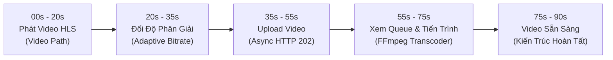

# KỊCH BẢN DEMO CHI TIẾT — MINI YOUTUBE SYSTEM DESIGN

> **Mục tiêu tài liệu:** Cung cấp kịch bản trình diễn (Demo Scripts) từng bước từ cơ bản đến chuyên sâu, phân vai thao tác và lời thoại chuẩn bị cho các buổi báo cáo tiến độ, thuyết trình đồ án hoặc bảo vệ trước Hội đồng phản biện.

---

## 1. Chuẩn bị Trước Buổi Demo (Checklist Tránh "Demo Effect")

Thực hiện kiểm tra các bước sau **5 phút trước khi bắt đầu thuyết trình**:

| STT | Bước chuẩn bị | Lệnh kiểm tra | Kết quả kỳ vọng |
|:---:|---|---|---|
| 1 | Kiểm tra Node.js & FFmpeg | `node -v` && `ffmpeg -version` | Node $\ge 18$, FFmpeg nhận lệnh |
| 2 | Khởi tạo dữ liệu mẫu (Seed) | `npm run seed` | Sinh file `fixtures/sample_720p.mp4` & tạo sẵn 1 video `READY` |
| 3 | Chạy API Server | `npm run dev:server` | Lắng nghe tại `http://localhost:3001` (SQLite WAL sẵn sàng) |
| 4 | Chạy React Client | `npm run dev:client` | Truy cập mượt mà tại `http://localhost:5173` |
| 5 | Dọn tab trình duyệt | Mở sẵn 2 tab: `localhost:5173` và `localhost:5173` (tab thứ hai mở F12 &gt; Network) | Không bị phân tâm bởi các ứng dụng khác |

---

## 2. Kịch bản 1: Demo Nhanh 90 Giây (Elevator Pitch)
> **Phù hợp:** Báo cáo nhanh tiến độ, mở đầu buổi bảo vệ hoặc trình diễn tính năng cốt lõi cho người nghe không chuyên sâu.



### Chi tiết các bước thực hiện:
* **00s – 20s (Minh chứng Video Path & Giao thức HLS):**
  * **Thao tác:** Bấm Play trên video mẫu *Demo Ready Video (720p HLS)*. Mở tab F12 Network, gõ lọc `.ts` hoặc `.m3u8`.
  * **Lời thoại:** *"Hệ thống không truyền trực tiếp file MP4 nguyên khối mà sử dụng chuẩn streaming HLS của Apple. Thầy/cô có thể thấy trình duyệt đang tải playlist `master.m3u8` và các gói phân đoạn `.ts` dài 4 giây trực tiếp từ Media Server."*
* **20s – 35s (Minh chứng Adaptive Bitrate - ABR):**
  * **Thao tác:** Bấm vào biểu tượng bánh răng trên trình phát, chuyển đổi qua lại giữa **Auto**, **360p** và **720p**.
  * **Lời thoại:** *"Trình phát `hls.js` tự động đo băng thông mạng để nhảy chất lượng mượt mà, hoặc cho phép người xem chọn độ phân giải mà không hề phải tải lại video từ đầu."*
* **35s – 55s (Minh chứng Asynchronous Ingestion & HTTP 202):**
  * **Thao tác:** Bấm **Tải Video Lên**, chọn file `fixtures/sample_720p.mp4`, bấm **Bắt Đầu Upload**.
  * **Lời thoại:** *"Khi người dùng upload, server lưu file tạm và trả về mã **HTTP 202 Accepted** ngay lập tức (~20ms). Hệ thống không encode đồng bộ để tránh làm nghẽn CPU và timeout HTTP."*
* **55s – 75s (Minh chứng Queue & Xử lý Tiến trình):**
  * **Thao tác:** Quan sát thẻ video mới chuyển trạng thái sang `PROCESSING` với thanh tiến trình phần trăm tăng dần. Terminal server hiển thị log FFmpeg đang xử lý ngầm.
  * **Lời thoại:** *"Tác vụ được đưa vào hàng đợi Transcode Queue. Worker FFmpeg chạy ngầm ở tiến trình riêng, vừa encode vừa cập nhật tiến trình % thời gian thực."*
* **75s – 90s (Hoàn tất chuỗi & Đối chiếu Kiến trúc):**
  * **Thao tác:** Trạng thái chuyển thành `READY`. Bấm xem video mới tạo ngay trên giao diện.
  * **Lời thoại:** *"Quá trình hoàn tất, video mới phát được ngay lập tức với đầy đủ các rendition. Toàn bộ luồng dữ liệu tuân thủ chuẩn kiến trúc hai đường truyền độc lập của YouTube."*

---

## 3. Kịch bản 2: Demo Chuyên Sâu 5 Phút (Bảo Vệ Đồ Án / Hội Đồng Phản Biện)
> **Phù hợp:** Bảo vệ trước hội đồng giảng viên, người chấm muốn xem xét chi tiết kiến trúc, benchmark hiệu năng và kiểm thử chịu tải.

### Phần 1: Phân tách Hai Đường Dữ Liệu (Control Path vs Video Data Path) — *1 phút*
1. **Thao tác:**
   * Trên thanh Menu, bấm nút **"Giải Thích Kiến Trúc"** (hoặc mở *Mô Phỏng 3D Kiến Trúc*).
   * Chỉ vào 2 nhánh: Nhánh màu đỏ (Video Data Path) và nhánh màu xanh (Control Path).
2. **Lời thuyết minh:**
   > *"Thưa thầy cô, điểm mấu chốt của kiến trúc YouTube là phân tách hai đường truyền:
   > - **Control/Metadata Path (Luồng nhẹ):** Xử lý các request JSON, metadata video, xác thực, và polling trạng thái. Lưu lượng siêu nhẹ và có thể scale lên hàng chục ngàn RPS dễ dàng.
   > - **Video Data Path (Luồng nặng):** Chứa file nhị phân video từ vài chục MB đến nhiều GB. Luồng này đi qua Object Storage, Worker chuyển mã riêng biệt và phân phối qua CDN Edge."*

---

### Phần 2: Kiểm chứng Tầng Đệm & Trạng thái Bất đồng bộ (Redis & Ingestion) — *1 phút*
1. **Thao tác:**
   * Mở giao diện **YouTube Studio** (bấm icon Admin trên góc phải).
   * Tại tab tổng quan, chỉ vào thẻ **Redis Cache Status** và **Tỉ lệ Cache HIT của CDN**.
   * Thực hiện upload 1 video mới để cho thấy trạng thái `QUEUED` đổi sang `PROCESSING`.
2. **Lời thuyết minh:**
   > *"Khi client liên tục polling `/api/v1/videos/:id/status` để hiển thị thanh tiến trình 10%, 20%,... 100%, nếu request nào cũng chọc vào database sẽ gây nghẽn I/O đĩa. Vì vậy, hệ thống sử dụng **Redis** làm tầng đệm RAM:
   > - Request polling chỉ mất **~1ms** để đọc trạng thái từ RAM.
   > - Database chính (SQLite/PostgreSQL) chỉ nhận các lệnh ghi quan trọng khi trạng thái thay đổi."*

---

### Phần 3: Thử nghiệm Đo Hiệu Năng & Waterfall Breakdown (Telemetry) — *1 phút*
1. **Thao tác:**
   * Trong màn hình YouTube Studio, bấm sang tab **"Đo Hiệu Năng & Báo Cáo Phân Tách Hai Luồng (Telemetry)"**.
   * Bấm nút màu xanh: **"Chạy Thử Nghiệm Đo Tải (Benchmark)"**.
   * Chờ 2 - 3 giây để hệ thống tự động sinh tệp và chạy pipeline đo đạc.
   * Quan sát khối kết quả **Waterfall Breakdown**:
     - *1. API Ingestion:* ~20 ms
     - *2. Queue Wait:* ~0 – 30 ms
     - *3. Transcoding FFmpeg:* ~1500 ms
     - *4. Total Time-to-Ready:* ~1600 ms
2. **Lời thuyết minh:**
   > *"Hệ thống tích hợp sẵn telemetry thu thập thông số thời gian thực theo từng chặng. Thầy cô có thể thấy rõ:
   > - Thời gian tiếp nhận API chỉ mất **20ms**, người dùng không hề bị treo trình duyệt.
   > - Tốc độ chuyển mã FFmpeg đạt hệ số **Speed Factor > 3.0x**, nghĩa là encode nhanh gấp 3 lần thời gian phát thực tế.
   > - Tỉ lệ nén dung lượng (Compression Ratio) và tổng dung lượng nạp vào/xuất ra được ghi nhận đầy đủ vào database."*

---

### Phần 4: Kiểm Thử Chịu Tải Cực Hạn (Stress Testing Suite) — *1.5 phút*
1. **Thao tác:**
   * Tại mục **"Kiểm Thử Chịu Tải & Giới Hạn Hệ Thống (Stress Testing Suite)"**:
   * **Lần 1 (Bắn tải API Metadata):** Chọn Target = `API Metadata`, Concurrency = `100 VUs`, Duration = `5 Giây`. Bấm **"Bắt Đầu Bắn Tải (Run Stress Test)"**.
     * Chỉ vào kết quả: Thông lượng đạt **~10.000 – 12.000 RPS**, Độ trễ trung bình $\approx 7\text{ms}$, `p99 < 25ms`, tỉ lệ thành công `100%`.
   * **Lần 2 (Bắn tải CDN Video Stream):** Chọn Target = `CDN Video Stream` (`.ts` chunk), Concurrency = `250 VUs` hoặc `500 VUs`, Duration = `5 Giây`. Bấm **"Bắt Đầu Bắn Tải"**.
     * Chỉ vào kết quả: Thông lượng vọt lên **hơn 20.000 RPS**, băng thông mạng đạt hàng chục **MB/s**, tỉ lệ Cache HIT đạt **> 98%**.
2. **Lời thuyết minh:**
   > *"Đây là minh chứng rõ ràng nhất cho năng lực chịu tải của kiến trúc:
   > - Dưới áp lực của hàng trăm kết nối đồng thời liên tục (Think time = 0), API vẫn giữ độ trễ cực thấp dưới 10ms nhờ cơ chế bất đồng bộ.
   > - Phân đoạn video `.ts` là bất biến (immutable), nên khi người xem đầu tiên kích hoạt nạp file, CDN Edge lưu ngay vào cache RAM. Hàng nghìn người xem tiếp theo được phục vụ trực tiếp tại biên mạng với độ trễ gần như bằng 0 mà không chạm vào ổ cứng Origin Storage."*

---

### Phần 5: Khám phá Cấu trúc Lưu trữ File & Xử lý Lỗi (Deep Dive & Fault Tolerance) — *30 giây*
1. **Thao tác:**
   * Bấm vào tab **"Quản Lý Kho Video"**, chọn một video bất kỳ và bấm **"Chi Tiết Tệp"**.
   * Chỉ cho người nghe thấy:
     - Tệp gốc: `originals/<uuid>.mp4`
     - Tệp danh sách phát: `master.m3u8`
     - Các playlist chất lượng: `360p.m3u8`, `720p.m3u8`
     - Hàng chục phân đoạn slice nhỏ: `360p_000.ts`, `720p_000.ts`,...
2. **Lời thuyết minh:**
   > *"Hệ thống kiểm soát tệp chặt chẽ với tên file dựa trên UUID để chống trùng lặp. Khi cần xóa video, hệ thống tự động dọn dẹp sạch sẽ toàn bộ thư mục HLS và file gốc để tránh rò rỉ dung lượng ổ đĩa."*

---

## 4. Kịch bản 3: Xử lý Tình Huống Góc (Edge Cases & Fault Tolerance)
> **Phù hợp:** Thể hiện sự chỉn chu khi giám khảo hỏi về các trường hợp biên hoặc tình huống ngoại lệ.

```
                    [Video Nguồn Upload]
                             │
                             ▼
                    Chạy ffprobe Đọc Height
                             │
            ┌────────────────┴────────────────┐
            ▼                                 ▼
      Height < 720px                    Height >= 720px
            │                                 │
     Chỉ sinh 360p HLS                Sinh cả 360p & 720p HLS
  (Tránh upscale lãng phí)         (Đầy đủ multi-renditions)
```

### Kịch bản 3.1: Video nguồn độ phân giải thấp (Không Upscale bậy)
* **Tình huống:** Người dùng upload video 480p hoặc 360p.
* **Cách demo:**
  * Chọn video có chiều cao $< 720\text{px}$.
  * Sau khi transcode xong, mở trình phát: Menu chất lượng chỉ hiển thị **360p**, không có **720p**.
  * **Giải thích:** *"Worker chạy `ffprobe` trước để kiểm tra chiều cao video. Hệ thống kiên quyết không upscale video 360p lên 720p vì vừa làm mờ hình ảnh vừa lãng phí CPU và băng thông lưu trữ."*

### Kịch bản 3.2: Thử lại tác vụ khi Worker gặp sự cố (Retry & Idempotency)
* **Tình huống:** Giả lập video bị lỗi hoặc hệ thống cần mã hóa lại.
* **Cách demo:**
  * Vào màn hình quản trị YouTube Studio, tại video bị lỗi hoặc cần làm mới, bấm nút **"Thử Lại" (Retry)**.
  * Trạng thái video được reset an toàn về `QUEUED` và đẩy lại vào Transcode Queue mà không làm hỏng dữ liệu gốc.

---

## 5. Bảng Phân Vai Thao Tác & Lời Nói Tóm Tắt (Quick Reference Card)

| Giây thứ | Hành động trên màn hình | Lời thoại trọng tâm | Điểm cần nhấn mạnh |
|:---:|---|---|---|
| **00 – 15s** | Play video mẫu, bật F12 lọc `.ts` | *"HLS cắt video thành các mảnh 4 giây, tải mượt mà từ CDN."* | Trình duyệt chỉ tải segment đang xem, không tải cả video |
| **15 – 30s** | Chuyển độ phân giải từ 720p $\to$ 360p | *"Player chuyển sub-playlist tức thì không cần tải lại trang."* | Cơ chế Adaptive Bitrate (ABR) |
| **30 – 50s** | Bấm upload file mẫu MP4 | *"Server nhận file và trả ngay HTTP 202 Accepted trong 20ms."* | Bất đồng bộ, không nghẽn thread |
| **50 – 70s** | Xem thanh tiến trình % tăng dần | *"Transcode Queue điều phối FFmpeg xử lý ngầm ở background."* | Cập nhật tiến trình qua WebSocket / Polling |
| **70 – 90s** | Video READY, mở tab Telemetry | *"Toàn bộ thời gian xử lý và tốc độ mã hóa được lưu telemetry."* | Minh chứng bằng số liệu khoa học |
| **90 – 120s** | Bấm chạy Stress Test 100 VUs | *"Hệ thống đạt hơn 10.000 RPS với độ trễ chỉ 7ms."* | Năng lực chịu tải của Redis + CDN Edge |

---

## 6. Lời Kết Mẫu Cho Bài Thuyết Trình

> *"Kính thưa Hội đồng/Thưa Thầy Cô, thông qua bản demo thực nghiệm vừa rồi, nhóm đã chứng minh trọn vẹn việc áp dụng thành công các nguyên lý thiết kế hệ thống lớn của YouTube:  
> 1. Phân tách rành mạch hai đường truyền dữ liệu (Control Path & Video Path).  
> 2. Cơ chế tiếp nhận bất đồng bộ giải phóng tài nguyên CPU (HTTP 202).  
> 3. Tối ưu hóa phân phối nội dung thông qua chuẩn HLS kết hợp bộ đệm CDN Edge & Redis.  
> 4. Toàn bộ hiệu năng và độ trễ được đo đạc, kiểm chứng minh bạch bằng số liệu Telemetry thực tế.  
> Em xin chân thành cảm ơn và sẵn sàng lắng nghe câu hỏi từ Hội đồng."*
