# MINI YOUTUBE — KIẾN TRÚC, CÁC LUỒNG XỬ LÝ & MÃ NGUỒN CỐT LÕI

> **Mã tài liệu:** MYT-ARCH-GUIDE-001  
> **Dự án:** Mini YouTube — Mô phỏng kiến trúc *Design YouTube* (Alex Xu, Chương 14)  
> **Mục tiêu tài liệu:** Cung cấp tài liệu học tập toàn diện về kiến trúc hệ thống, 4 luồng xử lý (workflows) cốt lõi, cùng mã nguồn và giải thích chi tiết các hàm xử lý then chốt.

---

## MỤC LỤC
1. [Tổng quan kiến trúc: Hai đường truyền dữ liệu (Two Paths)](#1-tổng-quan-kiến-trúc-hai-đường-truyền-dữ-liệu-two-paths)
2. [Chi tiết 4 luồng xử lý chính (System Workflows)](#2-chi-tiết-4-luồng-xử-lý-chính-system-workflows)
   * [Luồng 1: Tiếp nhận Video bất đồng bộ (Async Ingestion Workflow)](#luồng-1-tiếp-nhận-video-bất-đồng-bộ-async-ingestion-workflow)
   * [Luồng 2: Hàng đợi & Chuyển mã thích ứng (Adaptive Bitrate Transcoding Pipeline)](#luồng-2-hàng-đợi--chuyển-mã-thích-ứng-adaptive-bitrate-transcoding-pipeline)
   * [Luồng 3: Polling trạng thái & Tầng đệm (Status Polling & Cache-Aside)](#luồng-3-polling-trạng-thái--tầng-đệm-status-polling--cache-aside)
   * [Luồng 4: Phát luồng HLS thích ứng & CDN Caching (HLS Playback & CDN Simulation)](#luồng-4-phát-luồng-hls-thích-ứng--cdn-caching-hls-playback--cdn-simulation)
3. [Bảng tổng hợp các hàm xử lý quan trọng](#3-bảng-tổng-hợp-các-hàm-xử-lý-quan-trọng)
4. [Mã nguồn chi tiết & Giải thích từng dòng](#4-mã-nguồn-chi-tiết--giải-thích-từng-dòng)
   * [4.1. Hàm `createVideo()` — Tiếp nhận upload bất đồng bộ](#41-hàm-createvideo--tiếp-nhận-upload-bất-đồng-bộ)
   * [4.2. Hàm `TranscodeQueue.processNext()` — Quản trị vòng đời Job Transcode](#42-hàm-transcodequeueprocessnext--quản-trị-vòng-đời-job-transcode)
   * [4.3. Hàm `Transcoder.probe()` — Trích xuất siêu dữ liệu qua `ffprobe`](#43-hàm-transcoderprobe--trích-xuất-siêu-dữ-liệu-qua-ffprobe)
   * [4.4. Hàm `Transcoder.encodeRendition()` — Phân đoạn HLS 4s bằng `ffmpeg`](#44-hàm-transcoderencoderendition--phân-đoạn-hls-4s-bằng-ffmpeg)
   * [4.5. Hàm `CdnEdgeSimulator.getMiddleware()` — Giả lập CDN Edge Caching (HIT/MISS)](#45-hàm-cdnedgesimulatorgetmiddleware--giả-lập-cdn-edge-caching-hitmiss)
   * [4.6. Hàm `getVideoStatus()` — Mô hình Cache-Aside với Redis & Database](#46-hàm-getvideostatus--mô-hình-cache-aside-với-redis--database)
   * [4.7. Hàm `initializePlayer()` — Tích hợp trình phát `Hls.js` & Chuyển độ phân giải](#47-hàm-initializeplayer--tích-hợp-trình-phát-hlsjs--chuyển-độ-phân-giải)
5. [Kiến thức System Design cốt lõi cần nhớ](#5-kiến-thức-system-design-cốt-lõi-cần-nhớ)

---

## 1. TỔNG QUAN KIẾN TRÚC: HAI ĐƯỜNG TRUYỀN DỮ LIỆU (TWO PATHS)

Điểm mấu chốt trong thiết kế hệ thống video quy mô lớn là sự phân tách triệt để giữa **Đường điều khiển (Control Path)** và **Đường truyền dữ liệu Media (Video Path)**:

```
[React Client :5173]
       │
       ├── (1) CONTROL PATH (JSON / Metadata API) ────────► [Express API :3001]
       │   - POST /api/v1/videos (Upload, trả 202 Accepted)          │
       │   - GET /api/v1/videos/:id/status (Polling)                 ▼
       │   - GET /api/v1/videos/:id/playback                 [SQLite Metadata & Redis]
       │                                                             │
       │                                                             ▼
       │                                                   [Transcode Queue]
       │                                                             │
       │                                                             ▼
       │                                                    [FFmpeg Runner]
       │                                                     (HLS 360p & 720p)
       │                                                             │
       └── (2) DATA/VIDEO PATH (Media Streaming) ◄───────────────────┘
           - Tải master.m3u8 & segments .ts qua [CDN Edge Cache / Media Origin]
```

* **Control Path (Luồng siêu dữ liệu/JSON):** Xử lý qua Express API, SQLite, Redis. Chỉ xử lý dữ liệu nhẹ dạng JSON (đăng ký video, tra cứu trạng thái, thống kê quản trị). Không bao giờ chuyển tải trực tiếp stream video.
* **Video Path (Luồng truyền phát Media):** Client tải trực tiếp từ Media Server / CDN Edge Cache. Dữ liệu gồm playlist `master.m3u8`, các playlist con (`360p.m3u8`, `720p.m3u8`) và các file phân đoạn `.ts` độ dài 4 giây.

---

## 2. CHI TIẾT 4 LUỒNG XỬ LÝ CHÍNH (SYSTEM WORKFLOWS)

```mermaid
flowchart TD
    subgraph W1["Luồng 1: Async Ingestion (Upload)"]
        A1[Client chọn file MP4] --> A2[Gửi POST multipart/form-data]
        A2 --> A3[Multer lưu tạm originals/UUID.mp4]
        A3 --> A4[Ghi nhận SQLite status: QUEUED]
        A4 --> A5[Đẩy Job vào TranscodeQueue]
        A5 --> A6[Trả ngay HTTP 202 Accepted cho Client]
    end

    subgraph W2["Luồng 2: Transcoding Pipeline (FFmpeg Worker)"]
        B1[Queue nhặt Job từ hàng đợi] --> B2[Chuyển status: PROCESSING]
        B2 --> B3[ffprobe đọc duration, width, height]
        B3 --> B4{Nguồn >= 720p?}
        B4 -- Có --> B5[Chạy FFmpeg tạo 360p + 720p]
        B4 -- Không --> B6[Chỉ tạo 360p - Tránh upscale]
        B5 & B6 --> B7[Sinh file master.m3u8 & playlist con]
        B7 --> B8[Validate file & Cập nhật status: READY]
    end

    subgraph W3["Luồng 3: Status Polling & Redis Cache"]
        C1[Client poll GET /status mỗi 2s] --> C2{Redis Cache có key?}
        C2 -- HIT --> C3[Trả nhanh status từ RAM]
        C2 -- MISS --> C4[Đọc SQLite -> Set cache Redis có TTL]
    end

    subgraph W4["Luồng 4: HLS Playback & CDN Simulation"]
        D1[Client gọi GET /playback] --> D2[Nhận URL master.m3u8]
        D2 --> D3[Hls.js yêu cầu nạp segment .ts]
        D3 --> D4{CDN RAM Cache có sẵn?}
        D4 -- HIT (RAM) --> D5[Trả dữ liệu tức thì - Header HIT]
        D4 -- MISS (Disk) --> D6[Đọc ổ đĩa -> Lưu vào RAM -> Trả dữ liệu MISS]
    end
```



### Luồng 1: Tiếp nhận Video bất đồng bộ (Async Ingestion Workflow)
1. **Người dùng tải video:** Chọn file MP4/MOV và tiêu đề trên giao diện React.
2. **Gửi multipart request:** Client gửi request `POST /api/v1/videos`.
3. **Tiếp nhận an toàn:** Multer lưu file tạm vào thư mục `storage/originals/<UUID>.mp4` (sinh mã UUID ngẫu nhiên để tránh xung đột và lỗi bảo mật path traversal).
4. **Ghi nhận Metadata:** API Server chèn bản ghi vào bảng `videos` với trạng thái `QUEUED` và tiến độ `progress = 0`.
5. **Đẩy Job vào Queue:** Tác vụ được enqueue vào `TranscodeQueue`.
6. **Phản hồi 202 Accepted:** API trả ngay lập tức mã `HTTP 202 Accepted` kèm `id` cho Client. Kết nối HTTP kết thúc ngay mà không phải chờ FFmpeg.

### Luồng 2: Hàng đợi & Chuyển mã thích ứng (Adaptive Bitrate Transcoding Pipeline)
1. **Worker nhặt Job:** `TranscodeQueue` kích hoạt hàm `processNext()`.
2. **Cập nhật tiến trình:** Chuyển trạng thái video sang `PROCESSING`.
3. **Phân tích nguồn (Probe):** Gọi `ffprobe` trích xuất các thông số kỹ thuật gốc: thời lượng (`duration`), chiều rộng (`width`), chiều cao (`height`), codec video.
4. **Lựa chọn Rendition phù hợp:**
   * Luôn sinh bản phân giải `360p` (640x360, bitrate 800k).
   * Chỉ sinh bản `720p` (1280x720, bitrate 2500k) nếu độ phân giải gốc $\ge 720\text{p}$. Thuật toán này ngăn chặn việc upscale lãng phí CPU và lưu trữ.
5. **Cắt HLS Segments:** FFmpeg mã hóa và cắt video thành các file `.ts` độ dài đúng 4 giây (`-hls_time 4`), gán keyframe đồng đều (`-g 48`). Tiến trình `time=HH:MM:SS.ms` được bóc tách theo thời gian thực để cập nhật tiến độ %.
6. **Sinh Master Playlist:** Tạo file `master.m3u8` liên kết các playlist phụ cùng thông số băng thông (`BANDWIDTH`).
7. **Kiểm tra tính toàn vẹn (Validation):** Kiểm tra sự tồn tại thực tế của `master.m3u8` và các file playlist phụ.
8. **Hoàn tất (READY):** Cập nhật trạng thái `READY` và ghi nhận chỉ số hiệu năng (độ trễ, hệ số nén, tốc độ encode).

### Luồng 3: Polling trạng thái & Tầng đệm (Status Polling & Cache-Aside)
1. Client React thiết lập vòng lặp gọi `GET /api/v1/videos/:id/status` mỗi 2 giây đối với các video đang `QUEUED` hoặc `PROCESSING`.
2. **Kiểm tra Redis:** Server kiểm tra key `status:<id>`.
   * **Cache HIT:** Trả về dữ liệu ngay từ RAM mà không cần đọc database SQLite.
   * **Cache MISS:** Truy vấn SQLite, format dữ liệu trả về và ghi ngược vào Redis kèm TTL (video đang xử lý: 2s; video đã READY: 3600s).

### Luồng 4: Phát luồng HLS thích ứng & CDN Caching (HLS Playback & CDN Simulation)
1. Người dùng bấm Play: Client gọi `GET /api/v1/videos/:id/playback`.
2. Server xác thực trạng thái video: Nếu chưa `READY`, trả về mã lỗi `409 Conflict (VIDEO_NOT_READY)`. Nếu đã `READY`, trả về URL trỏ tới `master.m3u8`.
3. Trình phát `Hls.js` khởi chạy, tải `master.m3u8` và các phân đoạn `.ts`.
4. **CDN Edge Caching Simulator:** Middleware `cdnManager` chặn các request nạp file `.ts`:
   * **HIT:** Nếu chunk đã nằm trong bộ nhớ RAM của CDN Node, trả về ngay kèm header `X-Cache-Status: HIT`.
   * **MISS:** Nếu chunk chưa có trong RAM, đọc từ ổ cứng Origin Storage, nạp vào bộ nhớ RAM rồi trả về với header `X-Cache-Status: MISS`.
5. `Hls.js` tự động giám sát tốc độ mạng của client để tự động đổi bitrate mượt mà hoặc cho phép người dùng chủ động chọn chất lượng 360p/720p.

---

## 3. BẢNG TỔNG HỢP CÁC HÀM XỬ LÝ QUAN TRỌNG

| STT | Tên hàm / Thành phần | Vị trí file mã nguồn | Vai trò cốt lõi trong System Design |
| :---: | :--- | :--- | :--- |
| **1** | `createVideo` | `server/src/modules/video.service.ts` | Sinh UUID an toàn, ghi nhận trạng thái `QUEUED`, enqueue job, trả `202 Accepted` |
| **2** | `processNext` | `server/src/transcoding/queue.ts` | Điều phối Worker, chuyển trạng thái `PROCESSING → READY`, tính toán telemetry hiệu năng |
| **3** | `probe` | `server/src/transcoding/transcoder.ts` | Dùng `ffprobe` bóc tách thông số kỹ thuật (độ phân giải, thời lượng) trước khi transcode |
| **4** | `encodeRendition` | `server/src/transcoding/transcoder.ts` | Gọi `ffmpeg` cắt HLS `.ts` 4s, kiểm soát GOP, parse stderr tính toán tiến độ % |
| **5** | `getMiddleware` | `server/src/infra/cdn.ts` | Mô phỏng CDN Edge Caching, phân tích trạng thái `HIT / MISS` |
| **6** | `getVideoStatus` | `server/src/modules/video.service.ts` | Áp dụng Cache-Aside Pattern với Redis + SQLite giảm tải cho Database |
| **7** | `initializePlayer` | `client/src/components/VideoPlayerModal.tsx` | Tích hợp thư viện Hls.js, quản lý Auto ABR và chuyển đổi độ phân giải |

---

## 4. MÃ NGUỒN CHI TIẾT & GIẢI THÍCH TỪNG DÒNG

---

### 4.1. Hàm `createVideo()` — Tiếp nhận upload bất đồng bộ
* **Đường dẫn:** `server/src/modules/video.service.ts`
* **Mã nguồn:**

```typescript
createVideo(title: string, uploadedFile: Express.Multer.File): { id: string; title: string; status: string } {
  // 1. Sinh UUID duy nhất cho video, tránh xung đột tên và path traversal
  const id = uuidv4();

  // 2. Lưu thông tin video vào cơ sở dữ liệu với trạng thái ban đầu là QUEUED
  VideoRepository.create({
    id,
    title: title.trim() || 'Untitled Video',
    status: 'QUEUED',
    original_path: uploadedFile.path, // Đường dẫn file vật lý được Multer lưu tạm
  });

  // 3. Đẩy Job vào hàng đợi chuyển mã (bất đồng bộ, không chờ FFmpeg thực thi)
  this.queue.addJob(id, uploadedFile.path);

  // 4. Trả về thông tin tiếp nhận để Controller phản hồi HTTP 202 Accepted cho Client
  return {
    id,
    title: title.trim() || 'Untitled Video',
    status: 'QUEUED',
  };
}
```

---

### 4.2. Hàm `TranscodeQueue.processNext()` — Quản trị vòng đời Job Transcode
* **Đường dẫn:** `server/src/transcoding/queue.ts`
* **Mã nguồn:**

```typescript
private async processNext(): Promise<void> {
  // Nếu worker đang bận xử lý job khác hoặc hàng đợi rỗng thì thoát
  if (this.isProcessing || this.queue.length === 0) {
    return;
  }

  this.isProcessing = true;
  const job = this.queue.shift()!; // Lấy job đầu tiên ra khỏi hàng đợi (FIFO)
  const { videoId, originalPath, enqueuedAt } = job;
  const startedAt = Date.now();
  const queueWaitMs = startedAt - enqueuedAt; // Tính thời gian job phải chờ trong queue

  console.log(`[Queue] Starting transcoding job for video: ${videoId} (Queue wait: ${queueWaitMs}ms)`);

  try {
    // 1. Đổi trạng thái video sang PROCESSING, đặt tiến độ khởi đầu 5%
    VideoRepository.updateStatus(videoId, 'PROCESSING', 5);

    // 2. Chạy ffprobe để trích xuất metadata (chiều dài, chiều rộng, thời lượng)
    const probe = await Transcoder.probe(originalPath);
    VideoRepository.updateMetadata(videoId, {
      duration: probe.duration,
      width: probe.width,
      height: probe.height,
    });

    // 3. Thiết lập thư mục lưu trữ HLS đầu ra: storage/videos/<id>/
    const outputDir = path.join(this.storageDir, 'videos', videoId);

    // 4. Chạy FFmpeg chuyển mã đa độ phân giải kèm callback cập nhật tiến độ
    const result = await Transcoder.transcode(videoId, originalPath, outputDir, (progress) => {
      VideoRepository.updateStatus(videoId, 'PROCESSING', progress);
    });

    // 5. Lưu danh sách các phiên bản chất lượng (Renditions: 360p, 720p) vào Database
    for (const r of result.renditions) {
      VideoRepository.addRendition({
        id: uuidv4(),
        video_id: videoId,
        quality: r.quality,
        width: r.width,
        height: r.height,
        bitrate: r.bandwidth,
        playlist_path: path.join('videos', videoId, `${r.quality}.m3u8`),
      });
    }

    // 6. Đánh dấu trạng thái hoàn thành: READY 100%
    VideoRepository.updateStatus(videoId, 'READY', 100);
    const finishedAt = Date.now();
    const transcodeLatencyMs = finishedAt - startedAt;
    const totalTimeToReadyMs = finishedAt - enqueuedAt;

    // 7. Thu thập dữ liệu hiệu năng (Dung lượng, hệ số nén, tốc độ encode)
    let originalSizeBytes = fs.statSync(originalPath).size;
    let outputSizeBytes = this.getFolderSize(outputDir);
    const compressionRatio = parseFloat((outputSizeBytes / originalSizeBytes).toFixed(2));
    const speedFactor = parseFloat((probe.duration / (transcodeLatencyMs / 1000)).toFixed(2));

    PerformanceRepository.record({
      video_id: videoId,
      file_size_bytes: originalSizeBytes,
      video_duration_sec: probe.duration,
      queue_wait_ms: queueWaitMs,
      transcode_latency_ms: transcodeLatencyMs,
      total_time_to_ready_ms: totalTimeToReadyMs,
      output_size_bytes: outputSizeBytes,
      compression_ratio: compressionRatio,
      transcode_speed_factor: speedFactor,
    });

    console.log(`[Queue] Successfully finished video ${videoId}. Time-to-Ready: ${totalTimeToReadyMs}ms`);
  } catch (error: any) {
    // Nếu gặp lỗi, chuyển trạng thái sang FAILED và lưu mã lỗi
    console.error(`[Queue] Error processing video ${videoId}:`, error);
    VideoRepository.updateStatus(videoId, 'FAILED', 0, {
      code: 'VIDEO_DECODE_ERROR',
      message: error.message || 'Transcoding failed',
    });
  } finally {
    this.isProcessing = false;
    this.processNext(); // Tự động xử lý job tiếp theo trong queue
  }
}
```

---

### 4.3. Hàm `Transcoder.probe()` — Trích xuất siêu dữ liệu qua `ffprobe`
* **Đường dẫn:** `server/src/transcoding/transcoder.ts`
* **Mã nguồn:**

```typescript
static probe(filePath: string): Promise<VideoProbeResult> {
  return new Promise((resolve, reject) => {
    // Cấu hình tham số gọi ffprobe xuất kết quả JSON
    const args = [
      '-v', 'quiet',
      '-print_format', 'json',
      '-show_format',
      '-show_streams',
      filePath,
    ];

    const proc = spawn('ffprobe', args);
    let stdout = '';
    let stderr = '';

    proc.stdout.on('data', (data) => { stdout += data.toString(); });
    proc.stderr.on('data', (data) => { stderr += data.toString(); });

    proc.on('close', (code) => {
      if (code !== 0) {
        return reject(new Error(`ffprobe failed with code ${code}: ${stderr}`));
      }

      try {
        const info = JSON.parse(stdout);
        // Tìm luồng video stream trong file
        const videoStream = info.streams?.find((s: any) => s.codec_type === 'video');

        if (!videoStream) {
          return reject(new Error('No video stream found in file'));
        }

        const duration = parseFloat(info.format?.duration || videoStream.duration || '0');
        const width = parseInt(videoStream.width || '0', 10);
        const height = parseInt(videoStream.height || '0', 10);
        const codec = videoStream.codec_name || 'unknown';

        resolve({ duration, width, height, codec });
      } catch (err) {
        reject(new Error(`Failed to parse ffprobe output: ${err}`));
      }
    });
  });
}
```

---

### 4.4. Hàm `Transcoder.encodeRendition()` — Phân đoạn HLS 4s bằng `ffmpeg`
* **Đường dẫn:** `server/src/transcoding/transcoder.ts`
* **Mã nguồn:**

```typescript
private static encodeRendition(
  originalPath: string,
  outputDir: string,
  rendition: RenditionConfig,
  duration: number,
  onStepProgress: (progress: number) => void
): Promise<void> {
  return new Promise((resolve, reject) => {
    const playlistPath = path.join(outputDir, `${rendition.quality}.m3u8`);
    const segmentPattern = path.join(outputDir, `${rendition.quality}_%03d.ts`);

    // Bộ lọc tỉ lệ: Giữ nguyên khung hình, chèn viền đen nếu khác tỉ lệ
    const scaleFilter = `scale=w=${rendition.width}:h=${rendition.height}:force_original_aspect_ratio=decrease,pad=${rendition.width}:${rendition.height}:(ow-iw)/2:(oh-ih)/2`;

    const args = [
      '-i', originalPath,
      '-vf', scaleFilter,
      '-c:v', 'libx264',
      '-b:v', rendition.videoBitrate,
      '-maxrate', rendition.videoBitrate,
      '-bufsize', `${parseInt(rendition.videoBitrate, 10) * 2}k`,
      '-preset', 'veryfast',          // Tối ưu tốc độ mã hóa
      '-g', '48',                     // GOP cố định 48 frames (2s tại 24fps)
      '-keyint_min', '48',
      '-sc_threshold', '0',           // Tắt scene detection để keyframe đều nhau
      '-c:a', 'aac',
      '-b:a', rendition.audioBitrate,
      '-ac', '2',
      '-f', 'hls',                    // Định dạng HLS
      '-hls_time', '4',               // Chia nhỏ mỗi phân đoạn dài 4 giây
      '-hls_playlist_type', 'vod',    // HLS VOD mode
      '-hls_segment_filename', segmentPattern,
      '-y',
      playlistPath,
    ];

    const proc = spawn('ffmpeg', args);
    let stderr = '';

    proc.stderr.on('data', (data) => {
      const text = data.toString();
      stderr += text;

      // Regex đọc dòng log 'time=00:01:23.45' của FFmpeg để tính % tiến độ
      const timeMatch = text.match(/time=(\d{2}):(\d{2}):(\d{2}\.\d{2})/);
      if (timeMatch && duration > 0) {
        const hours = parseFloat(timeMatch[1]);
        const minutes = parseFloat(timeMatch[2]);
        const seconds = parseFloat(timeMatch[3]);
        const currentTime = hours * 3600 + minutes * 60 + seconds;
        const ratio = Math.min(currentTime / duration, 1.0);
        onStepProgress(ratio); // Callback truyền tỉ lệ ra ngoài
      }
    });

    proc.on('close', (code) => {
      if (code === 0) resolve();
      else reject(new Error(`FFmpeg failed with code ${code}: ${stderr}`));
    });
  });
}
```

---

### 4.5. Hàm `CdnEdgeSimulator.getMiddleware()` — Giả lập CDN Edge Caching (HIT/MISS)
* **Đường dẫn:** `server/src/infra/cdn.ts`
* **Mã nguồn:**

```typescript
getMiddleware(storageDir: string) {
  return (req: Request, res: Response, next: NextFunction) => {
    const filePath = req.path; // Ví dụ: /videos/<id>/360p_000.ts

    // Chỉ áp dụng logic CDN đối với các file media (.ts, .m3u8)
    const isMedia = filePath.endsWith('.ts') || filePath.endsWith('.m3u8');
    if (!isMedia) return next();

    res.setHeader('Access-Control-Allow-Origin', '*');
    res.setHeader('X-CDN-Edge-Node', 'SGN-Edge-Node-01 (Local Edge Simulation)');

    const isManifest = filePath.endsWith('.m3u8');
    const contentType = isManifest ? 'application/vnd.apple.mpegurl' : 'video/MP2T';

    // 1. Kiểm tra trong bộ nhớ đệm CDN Edge (RAM Cache Map)
    const cached = this.cache.get(filePath);
    if (cached) {
      this.hits++;
      res.setHeader('X-Cache-Status', 'HIT'); // Đã có trong cache
      res.setHeader('Content-Type', cached.contentType);
      res.setHeader('Cache-Control', isManifest ? 'no-cache' : 'public, max-age=86400');
      res.send(cached.buffer);
      return;
    }

    // 2. Cache MISS: Đọc từ ổ cứng Origin Storage
    const fullPath = path.join(storageDir, filePath);
    if (!fs.existsSync(fullPath)) {
      res.setHeader('X-Cache-Status', 'MISS-NOT-FOUND');
      return res.status(404).send('Media chunk not found in Origin Storage');
    }

    try {
      const buffer = fs.readFileSync(fullPath);
      this.misses++;

      // Lưu phân đoạn vừa đọc vào RAM Edge Cache
      this.cache.set(filePath, {
        buffer,
        contentType,
        cachedAt: Date.now(),
      });

      res.setHeader('X-Cache-Status', 'MISS'); // Lần đầu tải, đánh dấu MISS
      res.setHeader('Content-Type', contentType);
      res.setHeader('Cache-Control', isManifest ? 'no-cache' : 'public, max-age=86400');
      res.send(buffer);
    } catch (err) {
      next(err);
    }
  };
}
```

---

### 4.6. Hàm `getVideoStatus()` — Mô hình Cache-Aside với Redis & Database
* **Đường dẫn:** `server/src/modules/video.service.ts`
* **Mã nguồn:**

```typescript
async getVideoStatus(id: string): Promise<{ id: string; status: string; progress: number; error: string | null } | null> {
  // 1. Kiểm tra trước trong Redis Cache
  const cached = await redisManager.get(`status:${id}`);
  if (cached) {
    try {
      return JSON.parse(cached); // Cache Hit: Phản hồi siêu tốc từ RAM
    } catch {}
  }

  // 2. Cache Miss: Truy vấn Database SQLite
  const video = VideoRepository.findById(id);
  if (!video) return null;

  const result = {
    id: video.id,
    status: video.status,
    progress: video.progress,
    error: video.error_message,
  };

  // 3. Thiết lập TTL linh hoạt: 2s cho video đang xử lý, 3600s cho video đã READY
  const ttl = video.status === 'READY' ? 3600 : 2;
  await redisManager.set(`status:${id}`, JSON.stringify(result), ttl);

  return result;
}
```

---

### 4.7. Hàm `initializePlayer()` — Tích hợp trình phát `Hls.js` & Chuyển độ phân giải
* **Đường dẫn:** `client/src/components/VideoPlayerModal.tsx`
* **Mã nguồn:**

```typescript
const initializePlayer = (masterUrl: string) => {
  const videoEl = videoRef.current;
  if (!videoEl) return;

  // Kiểm tra trình duyệt có hỗ trợ MSE (Media Source Extensions) không
  if (Hls.isSupported()) {
    const hls = new Hls({
      enableWorker: true,
      lowLatencyMode: true,
    });

    hlsRef.current = hls;
    hls.loadSource(masterUrl);  // Nạp luồng master.m3u8
    hls.attachMedia(videoEl);   // Gắn vào thẻ HTML5 <video>

    // Bắt sự kiện đọc xong Master Manifest
    hls.on(Hls.Events.MANIFEST_PARSED, () => {
      setLoading(false);
      // Trích xuất danh sách độ phân giải khả dụng (360p, 720p)
      const parsedLevels = hls.levels.map((lvl, index) => ({
        id: index,
        name: `${lvl.height}p`,
        height: lvl.height,
        bitrate: lvl.bitrate,
      }));
      setLevels(parsedLevels);
      videoEl.play().catch(() => {});
    });

    // Cơ chế tự phục hồi lỗi mạng hoặc lỗi frame của HLS
    hls.on(Hls.Events.ERROR, (_event, data) => {
      if (data.fatal) {
        switch (data.type) {
          case Hls.ErrorTypes.NETWORK_ERROR:
            hls.startLoad(); // Thử nạp lại kết nối mạng
            break;
          case Hls.ErrorTypes.MEDIA_ERROR:
            hls.recoverMediaError(); // Khôi phục lỗi giải mã frame media
            break;
          default:
            hls.destroy();
            setError('Lỗi không thể giải mã luồng HLS');
            break;
        }
      }
    });
  }
};

// Hàm chuyển đổi độ phân giải thủ công hoặc Auto (-1)
const handleQualityChange = (levelIndex: number) => {
  setCurrentLevel(levelIndex);
  if (hlsRef.current) {
    hlsRef.current.currentLevel = levelIndex; // -1: Auto ABR, 0: 360p, 1: 720p
    console.log(`[HLS] Quality manually set to level ${levelIndex}`);
  }
};
```

---

## 5. KIẾN THỨC SYSTEM DESIGN CỐT LÕI CẦN NHỚ

1. **Tại sao trả HTTP 202 thay vì 200?**
   * Quá trình encode video tốn rất nhiều tài nguyên CPU và thời gian. Nếu giữ kết nối HTTP chờ FFmpeg, kết nối sẽ bị timeout, làm cạn kiệt thread pool và sập server. HTTP `202 Accepted` thông báo client rằng yêu cầu đã được tiếp nhận an toàn và sẽ được xử lý ngầm trong hàng đợi.
2. **Tại sao dùng HLS (HTTP Live Streaming) thay vì file MP4 nguyên bản?**
   * File MP4 nguyên bản bắt buộc tải theo file lớn liên tục. Nếu người dùng tua đến giữa video hoặc mạng chập chờn, trải nghiệm sẽ rất kém. HLS chia nhỏ video thành các phân đoạn 4 giây, giúp người dùng xem đến đâu tải đến đó (tiết kiệm băng thông tối đa) và cho phép tự động chuyển độ phân giải thích ứng (Adaptive Bitrate) theo tốc độ mạng thực tế.
3. **Làm sao chống Upscale video chất lượng thấp?**
   * Trước khi mã hóa, worker bắt buộc chạy `ffprobe` để đo đạc chiều cao (`height`) của video gốc. Nếu video gốc nhỏ hơn 720p (ví dụ 480p hoặc 360p), hệ thống loại bỏ profile 720p và chỉ sinh bản 360p. Điều này tiết kiệm đáng kể thời gian encode và dung lượng đĩa.
4. **Cơ chế Cache-Aside giảm tải Database như thế nào?**
   * Trong giai đoạn video đang xử lý, hàng nghìn lượt polling trạng thái được gửi lên mỗi giây. Áp dụng Redis với TTL ngắn (2s) giúp 90%+ request được phục vụ trực tiếp từ bộ nhớ RAM, bảo vệ Database SQLite khỏi tình trạng bị nghẽn I/O.
